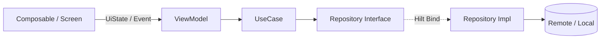

# FindMe Clean Architecture

FindMe는 **Clean Architecture**를 기반으로 멀티 모듈 구조를 사용합니다.  
비즈니스 규칙(Domain)과 UI·프레임워크(Presentation, Data)를 분리하여 테스트 용이성과 유지보수성을 확보합니다.

---

## 1. 아키텍처 원칙

| 원칙 | 설명 |
|------|------|
| **의존성 규칙** | 소스 코드 의존성은 항상 **안쪽(Domain)** 을 향합니다. Domain은 Android·Compose·Retrofit 등 외부 프레임워크에 의존하지 않습니다. |
| **단일 책임** | 각 레이어·클래스는 하나의 역할만 담당합니다. |
| **인터페이스 분리** | Repository는 Domain에 **interface**로 정의하고, Data 레이어에서 **구현**합니다. |
| **UseCase 단위** | 화면·기능별 비즈니스 로직은 UseCase 클래스로 캡슐화합니다. |

---

## 2. 모듈 구조

```
FindMe/
├── app/              # Application 진입점, Hilt 루트, Activity
├── presentation/     # UI (Jetpack Compose), ViewModel
├── domain/           # Entity, Repository interface, UseCase
└── data/             # Repository 구현, API, DB, DTO
```

### 2.1 모듈 의존성

```
┌─────────┐
│   app   │
└────┬────┘
     │ implementation
     ├──────────────┬──────────────┐
     ▼              ▼              ▼
┌─────────────┐ ┌─────────┐ ┌─────────────┐
│presentation │ │  data   │ │   domain    │
└──────┬──────┘ └────┬────┘ └─────────────┘
       │             │
       └──────┬──────┘
              ▼
        ┌──────────┐
        │  domain  │  ← 의존성 없음 (순수 Kotlin)
        └──────────┘
```

| 모듈 | Gradle 플러그인 | 의존 대상 |
|------|----------------|-----------|
| **domain** | `kotlin.jvm` | 없음 (`javax.inject`만) |
| **data** | `android.library` + Hilt + KSP | `:domain` |
| **presentation** | `android.library` + Compose + Hilt | `:domain` |
| **app** | `android.application` + Compose + Hilt | `:domain`, `:data`, `:presentation` |

> **주의:** `presentation`은 `data`에 **직접 의존하지 않습니다.** Repository 구현체는 Hilt를 통해 Domain 인터페이스로 주입됩니다.

---

## 3. 레이어별 역할

### 3.1 Domain (`:domain`)

**순수 Kotlin 모듈.** Android SDK를 사용하지 않습니다.

| 패키지 | 역할 | 예시 |
|--------|------|------|
| `model` | 비즈니스 엔티티 | `SampleModel` |
| `repository` | 데이터 접근 **인터페이스** | `SampleRepository` |
| `usecase` | 단일 비즈니스 액션 | `GetSampleUseCase` |

```kotlin
// domain/repository/SampleRepository.kt
interface SampleRepository {
    suspend fun getSampleData(): SampleModel
}

// domain/usecase/GetSampleUseCase.kt
class GetSampleUseCase(private val repository: SampleRepository) {
    suspend operator fun invoke(): SampleModel = repository.getSampleData()
}
```

**규칙**
- `Context`, `Retrofit`, `Room`, Compose import 금지
- UseCase는 `operator fun invoke()` 패턴 권장
- 복잡한 로직은 Domain `model` 또는 별도 domain service로 분리

---

### 3.2 Data (`:data`)

**Repository 구현**, 원격·로컬 데이터 소스, DTO ↔ Domain 매핑.

| 패키지 (예정) | 역할 |
|---------------|------|
| `repository` | `SampleRepositoryImpl` 등 Domain interface 구현 |
| `remote` | Retrofit API, Response DTO |
| `local` | Room Entity, DAO |
| `mapper` | DTO/Entity → Domain Model 변환 |
| `di` | Hilt `@Module` (Repository 바인딩) |

```kotlin
// data/repository/SampleRepositoryImpl.kt
class SampleRepositoryImpl : SampleRepository {
    override suspend fun getSampleData(): SampleModel {
        return SampleModel(1, "Clean Architecture Sample")
    }
}
```

**규칙**
- Domain `model`을 그대로 노출하지 않고, 매핑 레이어를 두는 것을 권장
- API 키·Base URL 등은 `BuildConfig` 또는 `local.properties`로 관리
- 공공데이터 API 연동 시 `docs/PUBLIC_DATA_API.md`, `docs/API_LIST.md` 참고

---

### 3.3 Presentation (`:presentation`)

**UI 및 상태 관리.** Jetpack Compose + (예정) ViewModel.

| 패키지 | 역할 |
|--------|------|
| `splash` | 스플래시 Composable (`AnimatedSplashScreen`) |
| `home` | Sample 기능 Screen, ViewModel, UiState |
| `ui.theme` | Material3 테마, 컬러, Typography |
| `feature.*` (예정) | 기능별 Screen, ViewModel, UiState |
| `navigation` (예정) | Compose Navigation |

**규칙**
- Composable은 **UiState**만 구독하고, 비즈니스 로직은 ViewModel·UseCase에 위임
- `data` 모듈 import 금지
- 디자인 토큰은 `docs/DESIGN_GUIDE.md` 준수

---

### 3.4 App (`:app`)

**앱 진입점 및 DI 그래프 루트.**

| 구성 | 역할 |
|------|------|
| `FindMeApplication` | `@HiltAndroidApp` |
| `MainActivity` | `@AndroidEntryPoint`, Compose `setContent` |
| `res/` | 런처 아이콘, 시스템 스플래시 테마 |

```kotlin
@HiltAndroidApp
class FindMeApplication : Application()

@AndroidEntryPoint
class MainActivity : ComponentActivity() { /* ... */ }
```

---

## 4. 데이터 흐름



**호출 방향:** `UI → ViewModel → UseCase → Repository → DataSource`

**데이터 반환:** Domain Model이 UseCase를 거쳐 ViewModel의 UiState로 변환되어 UI에 전달됩니다.

---

## 5. 의존성 주입 (Hilt)

| 항목 | 버전·도구 |
|------|-----------|
| DI | Hilt 2.59+ |
| 코드 생성 | KSP |
| Compose 연동 | `hilt-navigation-compose` (presentation 모듈) |

### 5.1 바인딩 패턴

**Data — Repository 바인딩**

```kotlin
// data/di/RepositoryModule.kt
@Module
@InstallIn(SingletonComponent::class)
abstract class RepositoryModule {
    @Binds
    @Singleton
    abstract fun bindSampleRepository(
        impl: SampleRepositoryImpl,
    ): SampleRepository
}
```

```kotlin
// data/repository/SampleRepositoryImpl.kt
class SampleRepositoryImpl @Inject constructor() : SampleRepository { /* ... */ }
```

**Domain — UseCase 주입**

```kotlin
// domain/usecase/GetSampleUseCase.kt
class GetSampleUseCase @Inject constructor(
    private val repository: SampleRepository,
) {
    suspend operator fun invoke(): SampleModel = repository.getSampleData()
}
```

**Presentation — ViewModel**

```kotlin
// presentation/home/HomeViewModel.kt
@HiltViewModel
class HomeViewModel @Inject constructor(
    private val getSampleUseCase: GetSampleUseCase,
) : ViewModel() { /* ... */ }
```

```kotlin
// presentation/home/HomeScreen.kt
@Composable
fun HomeScreen(viewModel: HomeViewModel = hiltViewModel()) { /* ... */ }
```

### 5.2 DI 그래프 (Sample)

```
FindMeApplication (@HiltAndroidApp)
└── SingletonComponent
    ├── SampleRepository ← SampleRepositoryImpl  (RepositoryModule @Binds)
    ├── GetSampleUseCase                         (@Inject constructor)
    └── HomeViewModel                            (@HiltViewModel)
```

### 5.3 적용 파일

| 파일 | 역할 |
|------|------|
| `app/.../FindMeApplication.kt` | `@HiltAndroidApp` |
| `app/.../MainActivity.kt` | `@AndroidEntryPoint` |
| `data/.../di/RepositoryModule.kt` | Repository `@Binds` |
| `presentation/.../home/HomeViewModel.kt` | `@HiltViewModel` |
| `presentation/.../home/HomeScreen.kt` | `hiltViewModel()` |

새 Repository 추가 시 `RepositoryModule`에 `@Binds` 메서드를 추가합니다. UseCase는 `@Inject constructor`만으로 Hilt가 자동 주입합니다.

---

## 6. 새 기능 추가 가이드

예: **유기동물 목록 조회** 기능

### Step 1 — Domain
1. `domain/model/AbandonedAnimal.kt` — 비즈니스 모델 정의
2. `domain/repository/AnimalRepository.kt` — interface 정의
3. `domain/usecase/GetAnimalListUseCase.kt` — UseCase 작성

### Step 2 — Data
1. `data/remote/dto/` — API Response DTO
2. `data/remote/AnimalApi.kt` — Retrofit interface
3. `data/mapper/AnimalMapper.kt` — DTO → Domain
4. `data/repository/AnimalRepositoryImpl.kt` — Repository 구현
5. `data/di/RepositoryModule.kt` — Hilt 바인딩

### Step 3 — Presentation
1. `presentation/feature/animal/list/AnimalListUiState.kt`
2. `presentation/feature/animal/list/AnimalListViewModel.kt`
3. `presentation/feature/animal/list/AnimalListScreen.kt`

### Step 4 — App
1. Navigation route 등록
2. 필요 시 `MainActivity` 또는 NavHost에서 Screen 연결

---

## 7. 기술 스택 (레이어별)

| 레이어 | 현재 | 예정 |
|--------|------|------|
| **UI** | Jetpack Compose, Material3 | Navigation Compose |
| **DI** | Hilt, KSP | — |
| **Domain** | 순수 Kotlin | — |
| **Network** | — | Retrofit2, OkHttp |
| **Local** | — | Room |
| **Async** | Kotlin Coroutines | Flow |

---

## 8. 테스트 전략

| 대상 | 위치 | 방법 |
|------|------|------|
| **UseCase** | `domain/src/test` | JUnit, Fake Repository |
| **Repository** | `data/src/test` | MockWebServer, in-memory Room |
| **ViewModel** | `presentation/src/test` | Turbine + Fake UseCase |
| **UI** | `app/src/androidTest` | Compose UI Test |

**원칙:** Domain·UseCase 테스트는 Android Instrumentation 없이 JVM에서 실행합니다.

---

## 9. 관련 문서

| 문서 | 내용 |
|------|------|
| [DESIGN_GUIDE.md](./DESIGN_GUIDE.md) | UI 컬러, 타이포, 스플래시 |
| [PLANNING.md](./PLANNING.md) | 서비스 기획·기능 정의 |
| [API_LIST.md](./API_LIST.md) | API 목록 |
| [PUBLIC_DATA_API.md](./PUBLIC_DATA_API.md) | 공공데이터 API 상세 |

---

*이 문서는 프로젝트 구조 변경 시 함께 업데이트합니다.*
